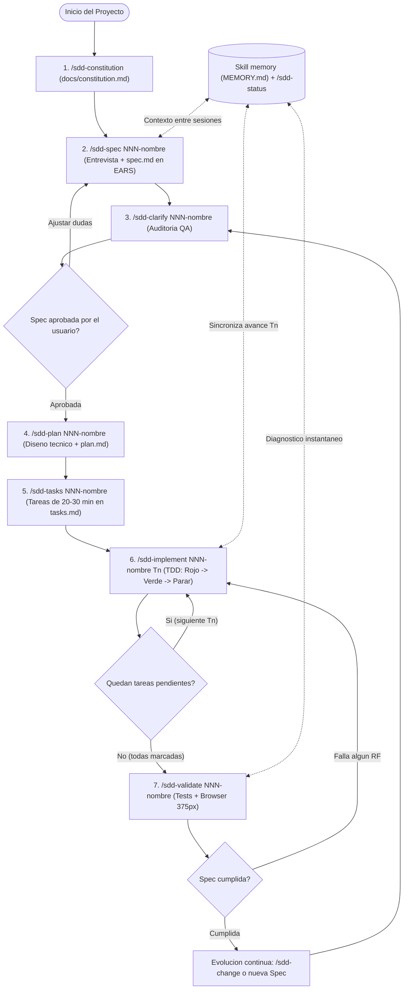

# Spec-Driven Development (SDD) Suite para Google Antigravity (AGY IDE)

Suite completa de **Agent Skills y Slash Commands** diseñada específicamente para **Google Antigravity (AGY IDE)** con un objetivo claro: **permitirte llevar un flujo profesional de Spec-Driven Development (SDD) de principio a fin únicamente mediante el uso de skills**, sin recordar prompts largos ni improvisar código fuera de especificación.

Está pensada para trabajar en un **flujo constante y continuo entre sesiones**: puedes pausar en cualquier tarea, cerrar el IDE y retomar horas o días después sabiendo exactamente qué se decidió, qué falta y cuál es el siguiente comando gracias a la combinación de las skills `/sdd-*` con la skill integrada **`memory`**.

---

## ¿Por qué usar esta Suite?

1. **SDD puro guiado solo por Skills**: Todo el ciclo de vida (**Spec-anchored** + sintaxis **EARS**) está encapsulado en skills modulares. Solo invocas el comando de la fase actual y el agente respeta automáticamente las compuertas de aprobación, la prohibición de tocar código antes de tiempo y el ciclo TDD tarea por tarea.
2. **Flujo constante sin pérdida de contexto (`memory` + `/sdd-status`)**: Incluye la skill **`memory`**, que lee `MEMORY.md` al arrancar cada sesión y registra decisiones, aprendizajes y próximos pasos al terminar cada avance (manteniéndolo compacto en ~50 líneas). Combinada con `/sdd-status`, alimenta el diagnóstico en tiempo real del proyecto para que nunca pierdas el ritmo.
3. **100% Nativa para AGY IDE**:
   - Cada carpeta en `.agents/skills/<nombre>/` funciona a la vez como **Slash Command** (`/sdd-*`, `/memory`) y como **Skill semántica con Progressive Disclosure**.
   - Aprovecha `ask_question` (entrevistas interactivas), `update_steps` / `update_focus` (progreso en vivo), el subagente `research` (auditoría QA imparcial), el MCP `context7` (documentación vigente) y el subagente `browser` / `chrome-devtools-mcp` (validación visual y móvil `375px`).
   - **Agnóstica al stack**: `sdd_helper.py` detecta automáticamente el lenguaje y test runner de tu proyecto (`node --test`, `vitest`, `jest`, `pytest`, `go test ./...`, `cargo test`, etc.).

---

## Diagrama del Flujo Constante SDD + Memory



---

## Estructura de la Suite

```text
.agents/skills/
├── memory/                           # Memoria viva del proyecto entre sesiones (MEMORY.md)
│   └── SKILL.md                      # Lee al iniciar sesión y resume decisiones/estado (~50 líneas)
├── sdd/                              # Skill maestro: flujo, reglas de oro y router
│   ├── SKILL.md
│   ├── references/
│   │   └── templates-and-ears.md     # Plantillas (constitution, spec, plan, tasks) + Guía EARS
│   ├── resources/
│   │   └── AGENTS.sdd-snippet.md     # Reglas SDD para AGENTS.md / GEMINI.md del proyecto
│   └── scripts/
│       └── sdd_helper.py             # CLI Python sin dependencias (status, detect-stack, next-id)
├── sdd-constitution/SKILL.md         # Fase 1: Principios innegociables (docs/constitution.md)
├── sdd-spec/SKILL.md                 # Fase 2: Entrevista y redacción de spec.md en EARS
├── sdd-clarify/SKILL.md              # Fase 3: Auditoría QA (detecta ambigüedades y conflictos)
├── sdd-plan/SKILL.md                 # Fase 4: Plan técnico y estrategia de tests (plan.md)
├── sdd-tasks/SKILL.md                # Fase 5: Tareas atómicas de 20-30 min (tasks.md)
├── sdd-implement/SKILL.md            # Fase 6: Implementación TDD de UNA sola tarea a la vez
├── sdd-validate/SKILL.md             # Fase 7: Validación RF por RF (tests + Browser/DevTools)
├── sdd-change/SKILL.md               # Mantenimiento Spec-anchored (primero spec, luego código)
└── sdd-status/SKILL.md               # Diagnóstico rápido apoyado en MEMORY.md y specs/
```

---

## Referencia Rápida de Comandos en AGY IDE

|  Orden   | Comando en el Chat de AGY IDE         | Qué hace                                                                                                     |
| :------: | :------------------------------------ | :----------------------------------------------------------------------------------------------------------- |
|  **1**   | `/sdd-constitution [contexto]`        | Analiza el proyecto y propone `docs/constitution.md` (6 principios innegociables). Espera tu aprobación.     |
|  **2**   | `/sdd-spec 001-nombre <idea>`         | Te hace hasta 5 preguntas clave y genera `specs/001-nombre/spec.md` en notación EARS (QUÉ y POR QUÉ).        |
|  **3**   | `/sdd-clarify 001-nombre`             | Revisa la spec como QA senior (ambigüedades, contradicciones, casos límite y choques con constitución).      |
|  **4**   | `/sdd-plan 001-nombre`                | Con la spec aprobada, diseña `plan.md` (archivos, funciones puras, pseudocódigo, decisiones y tests por RF). |
|  **5**   | `/sdd-tasks 001-nombre`               | Divide el plan en `tasks.md` con checkboxes, orden de dependencia y criterio `"Hecho cuando:"`.              |
|  **6**   | `/sdd-implement 001-nombre T1`        | Ejecuta **solo T1** con TDD (test en rojo → código en verde → marca `[x]` → actualiza `MEMORY.md` → para).   |
|  **7**   | `/sdd-validate 001-nombre`            | Verifica cada `RF-x` con tests + Browser/Chrome DevTools (`375px` móvil + consola) y emite veredicto.        |
| **Loop** | `/sdd-change 001-nombre <cambio>`     | Actualiza primero `spec.md` en EARS, muestra el diff e impacto en `plan.md`/`tasks.md` y espera aprobación.  |
| **Info** | `/sdd-status [001-nombre]`            | Cruza `specs/` y `MEMORY.md` para decirte en qué fase estás, avance `x/y` y el siguiente comando exacto.     |
| **Mem**  | `/memory`                             | Lee o actualiza `MEMORY.md` con el contexto clave, decisiones técnicas, aprendizajes y próximos pasos.       |

---

## Ejemplo Práctico Completo (Mini Caso Real)

Imagina que tienes una app de notas/estudio y quieres añadir un **contador de racha diaria** sin romper nada y manteniendo un flujo ordenado:

### Sesión 1: Definir las reglas y especificar antes de programar
1. **Crear principios del proyecto** (solo la primera vez):
   ```text
   /sdd-constitution App web ligera en TypeScript con Vitest, lógica pura sin acoplar al DOM.
   ```
   *→ El agente inspecciona el repo, propone `docs/constitution.md` en 15 líneas y espera tu "Aprobado" para guardarlo junto con `MEMORY.md`.*

2. **Especificar la funcionalidad**:
   ```text
   /sdd-spec 001-racha-diaria Mostrar cuántos días seguidos ha estudiado el usuario hasta hoy.
   ```
   *→ El agente NO toca código. Te pregunta con `ask_question`: "¿Qué ocurre si hoy aún no registra sesión pero ayer sí estudió?" y "¿Cuenta una sesión de 0 minutos?". Con tus respuestas crea `specs/001-racha-diaria/spec.md` con requisitos EARS (`RF-1: CUANDO...`, `RF-2: SI... ENTONCES...`).*

3. **Auditar, planificar y partir en tareas**:
   ```text
   /sdd-clarify 001-racha-diaria
   ```
   *→ Confirma que no hay contradicciones ni casos límite olvidados. Apruebas la spec y ejecutas:*
   ```text
   /sdd-plan 001-racha-diaria
   /sdd-tasks 001-racha-diaria
   ```
   *→ Genera `plan.md` (función pura `calculateStreak(sessions, today)` + estrategia Vitest) y `tasks.md` con 3 tareas pequeñas (`T1`, `T2`, `T3`).*

4. **Implementar la primera tarea con TDD**:
   ```text
   /sdd-implement 001-racha-diaria T1
   ```
   *→ Escribe primero el test de `calculateStreak` (falla en rojo), escribe la función pura (pasa en verde), marca `[x] T1` en `tasks.md`, actualiza `MEMORY.md` mediante las reglas de memoria y **se detiene** sin tocar `T2`.*

---

### Sesión 2 (Al día siguiente): Retomar el flujo constante en 5 segundos
Abres AGY IDE al día siguiente en una conversación limpia y escribes únicamente:
```text
/sdd-status
```
*→ Gracias a `MEMORY.md` (gestionado por la skill `memory`) y al escaneo de `specs/001-racha-diaria/`, el agente te responde al instante:*
> - **Fase actual**: Paso 6 — Implementación en curso (`spec.md` aprobada, `MEMORY.md` al día).
> - **Tareas**: `1 de 3` completadas (`T1` lista; pendientes `T2` y `T3`).
> - **Siguiente paso**: `/sdd-implement 001-racha-diaria T2`

Terminas `T2` y `T3`, validas todo el conjunto (tests + navegador en `375px`):
```text
/sdd-validate 001-racha-diaria
```
*→ `VEREDICTO: SPEC CUMPLIDA`. Y si una semana después quieres añadir un "comodín de descanso dominical", mantienes viva la spec sin improvisar:*
```text
/sdd-change 001-racha-diaria Permitir omitir los domingos sin perder la racha acumulada.
```

---

## Cómo Descargar y Aplicar desde GitHub en Otro Proyecto

Repositorio oficial: `https://github.com/ADOLFO-DEV/SDD_FOR_AI_AGENTS`

Puedes instalar toda la suite (incluyendo `memory`, `sdd` y los 9 comandos `/sdd-*`) en cualquier proyecto nuevo o existente:

### Opción 1: Aplicar en un proyecto específico (Recomendado para equipos / Git)

Ejecuta este comando en la **raíz de tu otro proyecto**. Clona la última versión en una carpeta temporal, copia todas las skills (`sdd*` y `memory`) a `.agents/skills/` y limpia los temporales sin ensuciar tu historial de Git:

**macOS / Linux:**
```bash
git clone --depth 1 https://github.com/ADOLFO-DEV/SDD_FOR_AI_AGENTS.git /tmp/sdd-agy \
  && mkdir -p .agents/skills \
  && cp -R /tmp/sdd-agy/.agents/skills/* .agents/skills/ \
  && chmod +x .agents/skills/sdd/scripts/sdd_helper.py \
  && rm -rf /tmp/sdd-agy
```

**Windows (PowerShell):**
```powershell
git clone --depth 1 https://github.com/ADOLFO-DEV/SDD_FOR_AI_AGENTS.git "$env:TEMP\sdd-agy"
New-Item -ItemType Directory -Force -Path ".agents\skills" | Out-Null
Copy-Item -Recurse -Force "$env:TEMP\sdd-agy\.agents\skills\*" ".agents\skills\"
Remove-Item -Recurse -Force "$env:TEMP\sdd-agy"
```

---

### Opción 2: Con el CLI estándar `npx skills` (`skills.sh`)

Desde la raíz de tu otro proyecto, instala directamente desde el repositorio de GitHub (te permitirá elegir alcance por proyecto o global):

```bash
npx skills add https://github.com/ADOLFO-DEV/SDD_FOR_AI_AGENTS
```

---

### Opción 3: Instalación Global en AGY IDE (Disponible en todos tus proyectos)

Si prefieres instalarlo una sola vez en tu máquina para tener `/sdd-*` y `/memory` disponibles en cualquier workspace de AGY IDE:

**macOS / Linux:**
```bash
git clone --depth 1 https://github.com/ADOLFO-DEV/SDD_FOR_AI_AGENTS.git /tmp/sdd-agy \
  && mkdir -p ~/.gemini/config/skills \
  && cp -R /tmp/sdd-agy/.agents/skills/* ~/.gemini/config/skills/ \
  && chmod +x ~/.gemini/config/skills/sdd/scripts/sdd_helper.py \
  && rm -rf /tmp/sdd-agy
```

**Windows (PowerShell):**
```powershell
git clone --depth 1 https://github.com/ADOLFO-DEV/SDD_FOR_AI_AGENTS.git "$env:TEMP\sdd-agy"
New-Item -ItemType Directory -Force -Path "$HOME\.gemini\config\skills" | Out-Null
Copy-Item -Recurse -Force "$env:TEMP\sdd-agy\.agents\skills\*" "$HOME\.gemini\config\skills\"
Remove-Item -Recurse -Force "$env:TEMP\sdd-agy"
```

---

### Opción 4: Pedírselo directamente al Agente en AGY IDE

Abre tu otro proyecto en **AGY IDE** y pega este prompt en el chat:

```text
Clona temporalmente https://github.com/ADOLFO-DEV/SDD_FOR_AI_AGENTS.git, copia todas las skills de .agents/skills/ (sdd* y memory) dentro de .agents/skills/ de este proyecto, dale permisos de ejecución a sdd_helper.py y elimina la carpeta temporal.
```

---

## Primeros Pasos tras Instalar en tu Proyecto

1. **Verifica la carga en AGY IDE**: Escribe `/sdd` o `/memory` en el chat de AGY IDE (si tenías la ventana abierta antes de copiar los archivos, inicia una **Nueva Conversación** para refrescar las skills).
2. **Inicializa la Constitución del proyecto (una sola vez)**:
   ```text
   /sdd-constitution
   ```
3. **Crea tu primera especificación funcional**:
   ```text
   /sdd-spec 001-mi-funcionalidad <describe qué quieres lograr y por qué>
   ```
4. **Mantén el flujo constante entre sesiones**: En cualquier momento usa `/sdd-status` o `/memory` para retomar exactamente donde te quedaste.
